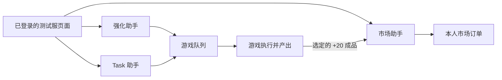

# Milky Way · 独立浏览器插件

[返回项目总览](https://github.com/ZhonghuaM/Milky-Way)

三个可分别安装的历史油猴插件，保留原有分工。发布文件取自保存的独立版快照，版本与校验值见 [release-manifest.json](release-manifest.json)。

| 插件 | 版本 | 功能 |
| --- | --- | --- |
| [队列强化助手](userscripts/mwi_safe_enhancer.user.js) | 1.6.10 | 根据选择的装备与新增数量规划强化并确认入队 |
| [市场守价助手](userscripts/mwi_market_keeper.user.js) | 1.3.3 | 独立维护指定物品的 +20 卖单 |
| [Task 任务助手](userscripts/mwi_task_queue.user.js) | 1.10.1 | 筛选任务、补料、追加生活动作及结算 |

**历史兼容性提醒：** 此 Task 快照早于符石材料保护更新。使用符石系统时，请关闭“自动出售（总开关）”和背包分类清理，避免自动出售符石耗材。本分支不保证兼容后续游戏更新。

## 安装

1. 在浏览器安装 Tampermonkey。
2. 打开所需脚本的文件页，点击 **Raw**，交由 Tampermonkey 安装；也可以复制完整文件到新建脚本。
3. 停用重复执行相同功能的旧脚本，保存后完整刷新测试服角色页面。
4. 等待角色、库存和对应模块状态完成同步，再核对面板设置并启动。

脚本仅匹配 `test.milkywayidle.com` 与 `test.milkywayidlecn.com`。初次使用时自动任务未启用；已有保存状态可能在完整同步后继续。

## 如何使用

**强化：** 准备游戏中保存的 `Enhancing` 配装，选择装备和新增数量，核对材料与计划后启动。显示完成表示计划中的动作已确认入队，并不表示所有 +20 成品已经产出。停止继续发送也不会删除游戏里已有的队列。

**市场：** 添加需要监控的物品，确认库存和本人订单已同步，再启用市场维护。它不读取或驱动强化批次。牛铃袋买单是独立选项，默认关闭。

**Task：** 准备对应技能配装，确认任务筛选和结算设置，再启动。历史快照支持挤奶、采集、伐木、奶酪锻造、制作、缝纫、烹饪和冲泡的生活任务排队，不包含炼金与强化。新动作追加到队尾，保留已有游戏队列。

三个插件可以按需共存；各自面板分别启停。浏览器冻结、电脑休眠或连接中断仍会影响运行。遇到无法确认的操作，保留已有记录并按面板提示核对，不要通过清空队列或站点数据来绕过提示。

## 工作关系



## 离线验证

本发布快照通过了下列六组离线测试。测试使用合成数据，不登录游戏；它们不等于在当前游戏版本上的完整实跑保证。

```bash
node userscripts/test_mwi_safe_enhancer.js
node userscripts/test_mwi_safe_enhancer_runtime.js
node userscripts/test_mwi_market_keeper_runtime.js
node userscripts/test_mwi_split_coexistence_runtime.js
node userscripts/test_mwi_task_queue.js
node userscripts/test_mwi_task_queue_coexistence.js
```

源文件保留原有 MIT 标记及作者/参考来源说明，见 [来源与许可说明](THIRD_PARTY_NOTICES.md)。当前 Python 整合实现不在此分支中。
