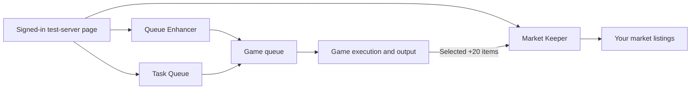

# Milky Way · Standalone Browser Userscripts

[Return to the project overview](https://github.com/ZhonghuaM/Milky-Way)

Three historical Tampermonkey userscripts, each with a separate role and installation. The published files come from saved standalone snapshots; their versions and checksums are listed in [release-manifest.json](release-manifest.json). The archived source files and their original interface language are unchanged.

| Userscript | Version | Purpose |
| --- | --- | --- |
| [Queue Enhancer](userscripts/mwi_safe_enhancer.user.js) | 1.6.10 | Plan enhancement for selected equipment and additional quantities, then confirm that the actions have entered the queue |
| [Market Keeper](userscripts/mwi_market_keeper.user.js) | 1.3.3 | Independently maintain +20 sell listings for selected items |
| [Task Queue](userscripts/mwi_task_queue.user.js) | 1.10.1 | Select tasks, replenish materials, append skilling actions and handle task settlement |

**Historical compatibility note:** This Task snapshot predates the talisman-material protection update. When using the talisman system, disable the main auto-sell switch and inventory category cleanup to avoid automatically selling talisman consumables. Compatibility with later game updates is not guaranteed.

## Installation

1. Install Tampermonkey in your browser.
2. Open the file page for the script you want, select **Raw**, and install it through Tampermonkey. Alternatively, copy the complete file into a new userscript.
3. Disable older scripts that duplicate the same function, save your changes, and fully refresh the test-server character page.
4. Wait for character, inventory and module state to finish synchronizing, then review the panel settings and start the module.

The scripts match only `test.milkywayidle.com` and `test.milkywayidlecn.com`. Automatic work is disabled on first use; previously saved state may resume after a complete synchronization.

## Using the tools

**Enhancement:** Prepare the saved in-game `Enhancing` loadout, select the equipment and additional quantities, and review the materials and plan before starting. A completed plan means its actions have been confirmed in the queue; it does not mean that all +20 items have already been produced. Stopping further submissions does not remove actions already in the game queue.

**Market:** Add the items you want to monitor, confirm that inventory and your own listings have synchronized, then enable market maintenance. It neither reads nor drives enhancement batches. Cowbell-bag buy orders are a separate option, disabled by default.

**Tasks:** Prepare the appropriate skill loadouts, review task selection and settlement settings, then start. This historical snapshot supports task queueing for Milking, Foraging, Woodcutting, Cheesesmithing, Crafting, Tailoring, Cooking and Brewing. It does not cover Alchemy or Enhancing. New actions are appended to the end of the queue, preserving existing game actions.

The three scripts can coexist as needed and are started or stopped from their own panels. Browser freezing, computer sleep and connection loss can still interrupt operation. If an action cannot be confirmed, preserve the existing records and follow the panel guidance; do not clear the queue or site data to bypass the warning.

## How the tools relate



## Offline validation

This release snapshot passed the following six offline test suites. They use synthetic data and do not log into the game; passing them does not guarantee a complete live run against the current game version.

```bash
node userscripts/test_mwi_safe_enhancer.js
node userscripts/test_mwi_safe_enhancer_runtime.js
node userscripts/test_mwi_market_keeper_runtime.js
node userscripts/test_mwi_split_coexistence_runtime.js
node userscripts/test_mwi_task_queue.js
node userscripts/test_mwi_task_queue_coexistence.js
```

The source files retain their original MIT markers and author/reference notices; see [Sources and license notices](THIRD_PARTY_NOTICES.md). The current integrated Python implementation is not included in this branch.

<sub><a href="https://github.com/ZhonghuaM/Milky-Way/blob/main/docs/usage-notes.md">Usage notes</a></sub>
