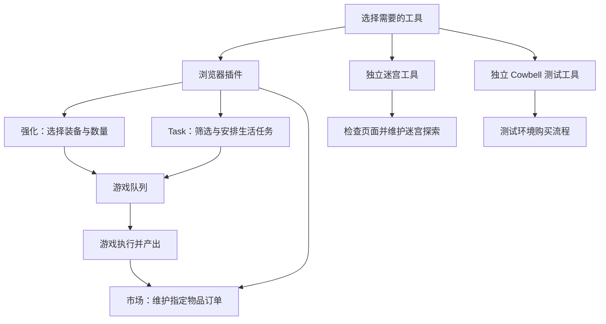
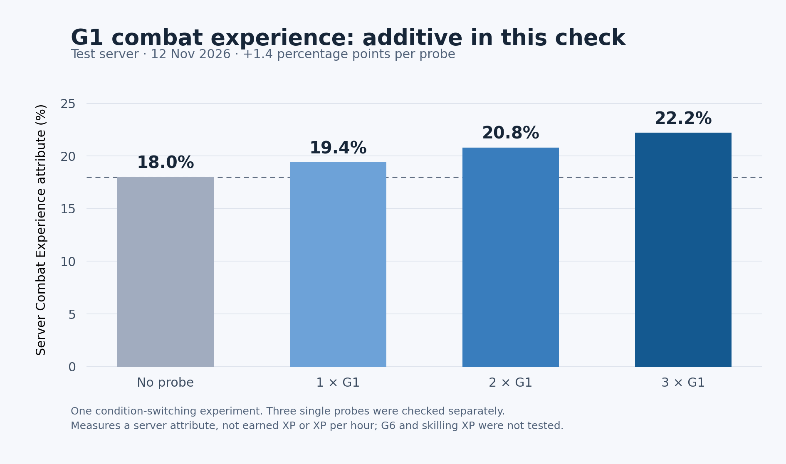

# Milky Way

银河奶牛测试服工具与实验记录。这个仓库统一收录早期独立工具，并展示后续自动化研究的功能设计与验证结果。

## 从这里开始

| 分支 | 内容 | 运行方式 |
| --- | --- | --- |
| **[main](https://github.com/ZhonghuaM/Milky-Way/tree/main)** | 总览、流程图和脱敏测试展示 | 阅读文档 |
| **[legacy/userscripts](https://github.com/ZhonghuaM/Milky-Way/tree/legacy/userscripts)** | 独立强化、市场、Task 三个历史插件 | Tampermonkey / 油猴 |
| **[legacy/autolabyrinth](https://github.com/ZhonghuaM/Milky-Way/tree/legacy/autolabyrinth)** | 独立迷宫工具 | Python + Playwright |
| **[legacy/autopay](https://github.com/ZhonghuaM/Milky-Way/tree/legacy/autopay)** | 早期 Cowbell 测试购买工具 | Python + Playwright |

`legacy/` 分支是经过检查的历史快照，各有独立的安装说明。它们不是当前整合系统的安装包，也不承诺适配后续游戏更新。当前整合版只展示功能与选定实验结果，实现代码、运行配置和账号数据不在本仓库中。

## 旧工具如何分工

强化助手确认的是**操作已经入队**，成品仍需要游戏继续执行。市场助手独立维护订单；它不会启动新的强化批次。Task 助手把新动作追加到已有队列。

## 图解与实验

- [整合系统的功能概览](docs/system-overview.md)：展示工作目标和模块关系，不提供实现细节。
- [经验叠加实验](docs/experience-study.md)：区分服务器属性变化与实际获得的经验。
- [公开版本与验证范围](docs/validation.md)：记录检查对象、测试方法和证据边界。

上图测量服务器属性，不是实际经验/小时；完整方法与限制见经验实验页。

## 使用范围

公开的工具面向 Milky Way Idle 测试环境。三个油猴脚本只匹配两个测试服域名；其他工具的限制见各分支说明。历史 Task 版本早于符石材料保护更新，使用符石系统时应关闭其自动出售和分类清理。

账号配置、浏览器登录状态、订单明细、运行日志及原始实验快照不随发布包提供。各组件保留原有许可说明和来源署名，具体见相应分支。

旧项目入口：[迷宫工具](https://github.com/ZhonghuaM/milkyway-autolabyrinth) · [测试购买工具](https://github.com/ZhonghuaM/milkyway-autopay)。后续项目导航以本仓库为准。
