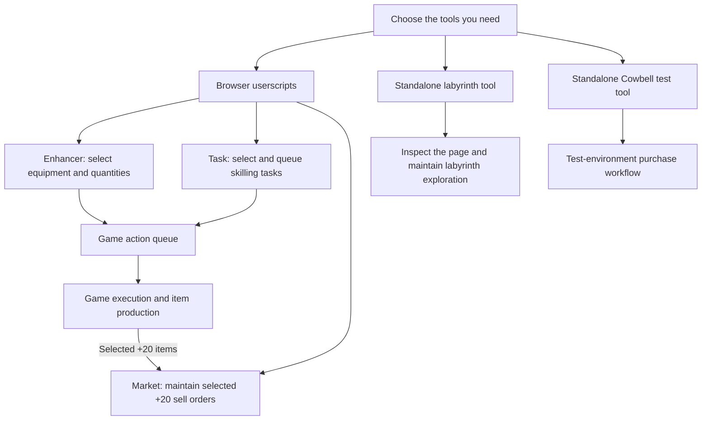

# Milky Way

Tools and experiment notes for the Milky Way Idle test environment. This repository brings together earlier standalone tools and presents the functional design and selected validation results of later automation research.

## Start here

| Branch | Contents | How to use it |
| --- | --- | --- |
| **[main](https://github.com/ZhonghuaM/Milky-Way/tree/main)** | Project overview, workflow diagrams and anonymised experiment summaries | Read the documentation |
| **[legacy/userscripts](https://github.com/ZhonghuaM/Milky-Way/tree/legacy/userscripts)** | Historical standalone enhancer, market and Task scripts | Tampermonkey |
| **[legacy/autolabyrinth](https://github.com/ZhonghuaM/Milky-Way/tree/legacy/autolabyrinth)** | Standalone labyrinth tool | Python + Playwright |
| **[legacy/autopay](https://github.com/ZhonghuaM/Milky-Way/tree/legacy/autopay)** | Historical Cowbell test-purchase tool | Python + Playwright |

The `legacy/` branches contain reviewed historical snapshots, each with its own setup instructions. They are not installation packages for the current integrated system, and compatibility with later game updates is not guaranteed. The current system is represented only by functional overviews and selected experiment results; its implementation, runtime configuration and account data are not included.

## How the standalone tools fit together

The enhancer confirms that **actions have entered the queue**; the game must still execute them to produce the items. The market script maintains orders independently and does not start new enhancement batches. The Task script appends new actions to the existing queue.

## Diagrams and experiments

- [Figure gallery](docs/figure-gallery.md): individual-probe checks, skill-experience observations and source attribution.
- [Integrated system overview](docs/system-overview.md): goals and module relationships, without implementation details.
- [Experience-stacking study](docs/experience-study.md): the distinction between server attribute changes and experience actually earned.
- [Public versions and validation scope](docs/validation.md): what was checked, how it was checked and what the evidence supports.

The chart measures a server attribute, not experience earned per hour. The study page explains the method and its limitations.

This short record is not a 35-minute benchmark. The gallery retains unclassified
experience and explains why the interval labels do not establish reward sources.

## Scope of use

The public tools target the Milky Way Idle test environment. The three userscripts match only the two test-server domains; the other tools' restrictions are described in their respective branches. The historical Task version predates the talisman-material protection update. Disable its automatic selling and inventory-category cleanup when using the talisman system.

Account configurations, browser login state, order details, runtime logs and raw experiment snapshots are excluded from the release. Each component retains its original licence notices and attribution; see the relevant branch.

Original project repositories: [labyrinth tool](https://github.com/ZhonghuaM/milkyway-autolabyrinth) · [test-purchase tool](https://github.com/ZhonghuaM/milkyway-autopay). This repository is the consolidated project entry point.

<a href="docs/usage-notes.md">Usage notes</a>
