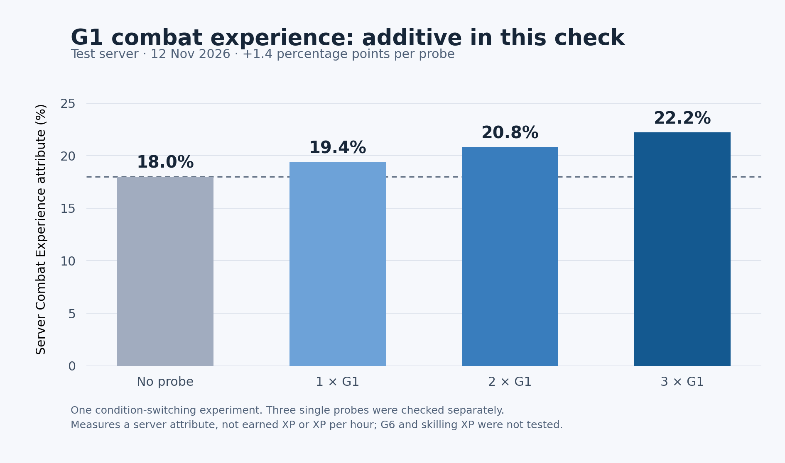
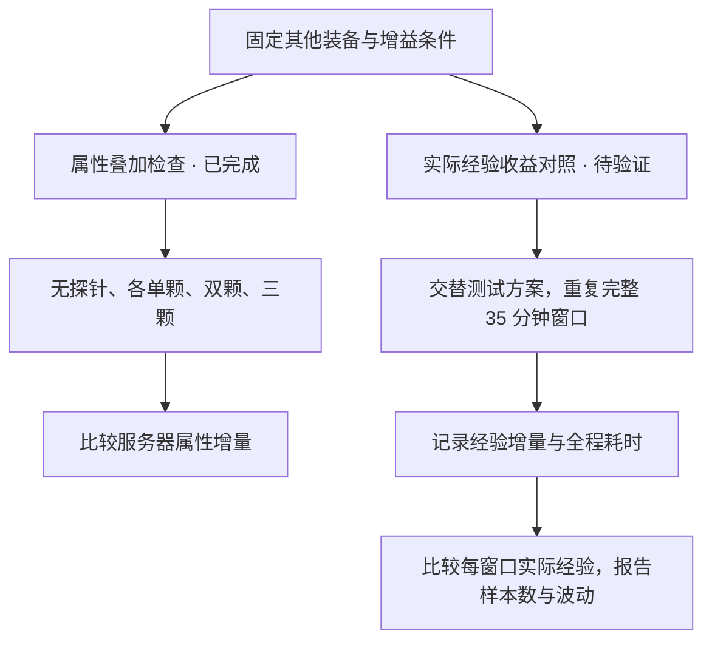

# 经验叠加与实际经验观测

测试日期：2026-11-12。以下为脱敏汇总；原始角色快照、物品标识和实验执行脚本未公开。

## 已验证：G1 通用战斗经验属性叠加

固定其他装备与增益条件，依次读取无探针、三个探针各自单独装备、两颗组合和三颗组合时的服务器 **Combat Experience** 属性。

| 装备条件 | 服务器 Combat Experience 属性 | 相对基线增加 |
| --- | ---: | ---: |
| 无探针 | 18.0% | 0.0 个百分点 |
| 单颗 G1；三个探针分别测试 | 均为 19.4% | 均为 1.4 个百分点 |
| 两颗 G1 | 20.8% | 2.8 个百分点 |
| 三颗 G1 | 22.2% | 4.2 个百分点 |

本次条件切换中，三颗 G1 通用战斗经验词条的服务器属性增量符合加法叠加。

**这不是实际经验奖励或经验/小时测试。** 这是单轮条件切换实验，未验证生活经验词条、G6 或所有其他增益组合，不能解读为“实际经验提高 4.2%”。

## 另一次观测：实际技能经验计数

| 指标 | 匿名汇总 |
| --- | ---: |
| 有效观测时长 | 274.70 秒，约 4 分 35 秒 |
| 七种生活技能累计经验增量 | 382,351.20 |
| 连续迷宫运行区间内记录的增量 | 256,332.16 |
| 来源未确定的增量 | 126,019.04 |

七种技能为挤奶、采集、伐木、烹饪、冲泡、炼金、强化；排除奶酪锻造、制作和缝纫。

这份记录测量实际技能经验计数的变化，但没有逐房奖励关联。即使在连续迷宫区间，也不能排除同时领取的其他经验。因此表中使用“区间内记录的增量”，不把它全部归因于迷宫奖励。

它不是完整的 35 分钟样本，也没有符石方案对照，不用于推算稳定经验/小时或宣称优化收益。它与上面的属性叠加检查是两次不同的观测。

## 下一步怎样验证收益

完整时间窗口应包括赶路、失败、战斗和等待。结果展示应同时保留配置条件与异常窗口，避免只挑选顺利完成的片段。这里仅说明实验思路，不提供内部控制程序或策略参数。
