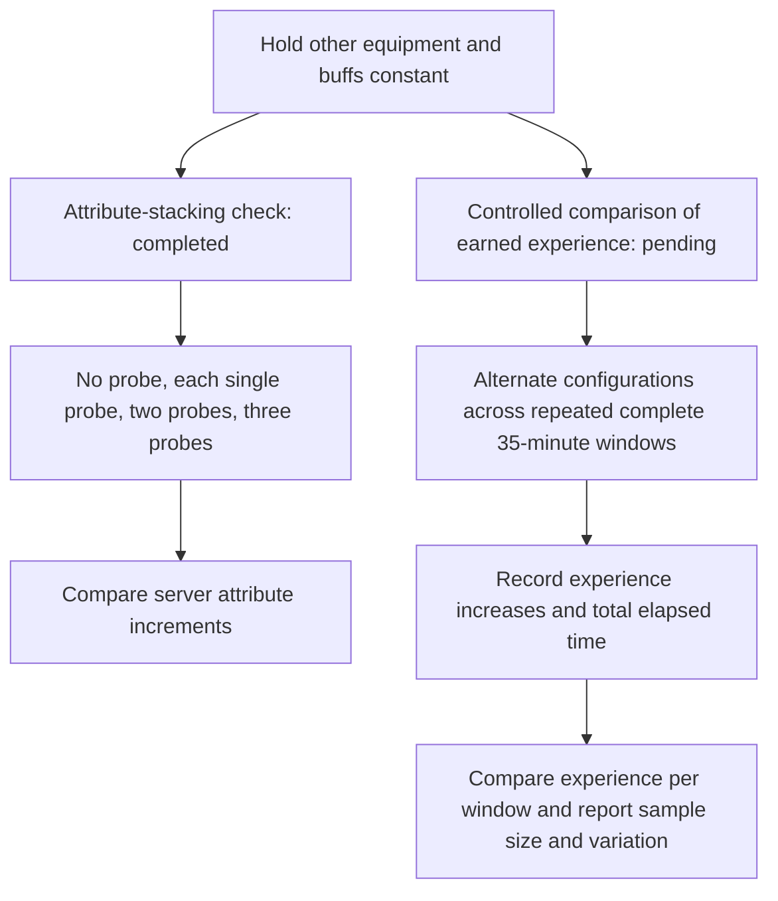

# Experience stacking and observed experience gains

Test date: 2026-11-12. The following summaries are anonymised. Raw character snapshots, item identifiers and experiment-control scripts are not public.

## Verified: G1 general Combat Experience attributes stack

With other equipment and buffs held constant, server **Combat Experience** readings were taken with no probe equipped, each of three probes equipped individually, a two-probe combination and a three-probe combination.

| Equipment condition | Server Combat Experience attribute | Increase from baseline |
| --- | ---: | ---: |
| No probe | 18.0% | 0.0 percentage points |
| One G1 probe; all three tested separately | 19.4% each | 1.4 percentage points each |
| Two G1 probes | 20.8% | 2.8 percentage points |
| Three G1 probes | 22.2% | 4.2 percentage points |

Across these condition changes, the server attribute increments from the three G1 general Combat Experience modifiers were consistent with additive stacking.

**This was not a test of actual experience rewards or experience per hour.** It was one sequence of condition changes. Skilling experience modifiers, G6 modifiers and all other buff combinations were not tested. The result must not be interpreted as “4.2% more experience earned”.

## A separate observation: actual skill-experience counters

| Measure | Anonymised summary |
| --- | ---: |
| Effective observation time | 274.70 seconds, approximately 4 minutes 35 seconds |
| Total experience increase across seven skilling skills | 382,351.20 |
| Increase recorded during continuous labyrinth intervals | 256,332.16 |
| Increase of undetermined origin | 126,019.04 |

The seven skills were Milking, Foraging, Woodcutting, Cooking, Brewing, Alchemy and Enhancing. Cheesesmithing, Crafting and Tailoring were excluded.

This record measures changes in actual skill-experience counters, but it does not associate rewards with individual rooms. Other experience may have been claimed during continuous labyrinth intervals. The table therefore reports an “increase recorded during” those intervals rather than attributing the entire increase to labyrinth rewards.

This was not a complete 35-minute sample and did not compare talisman configurations. It cannot support an estimate of sustained experience per hour or a claim of optimisation gains. It is a separate observation from the attribute-stacking check above.

## How actual gains could be tested next

Complete time windows should include travel, failures, combat and waiting. Results should retain configuration details and abnormal windows, rather than selecting only successful segments. This outlines an experimental approach; it does not provide the internal control program or strategy parameters.
