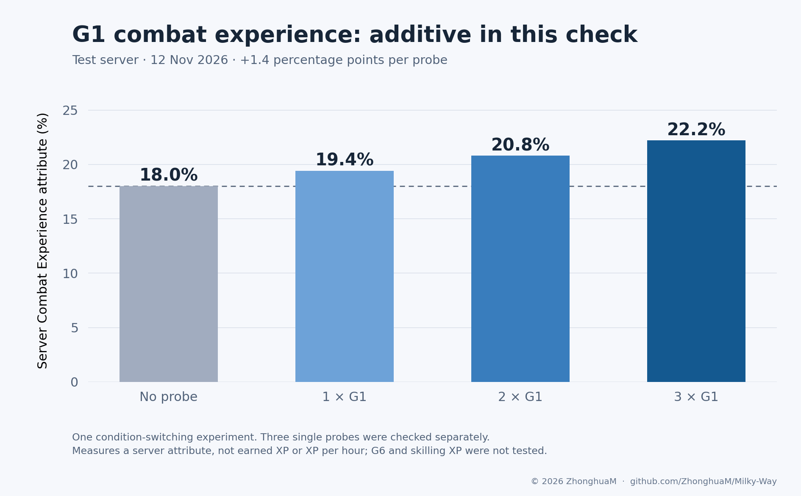
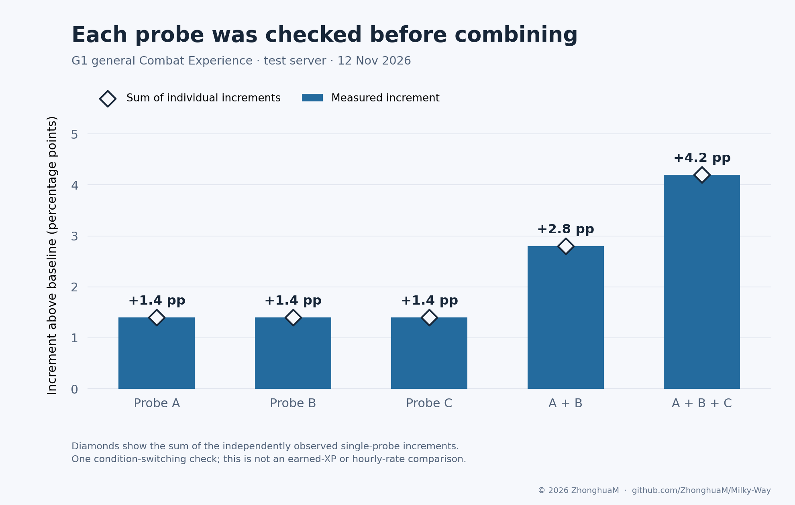
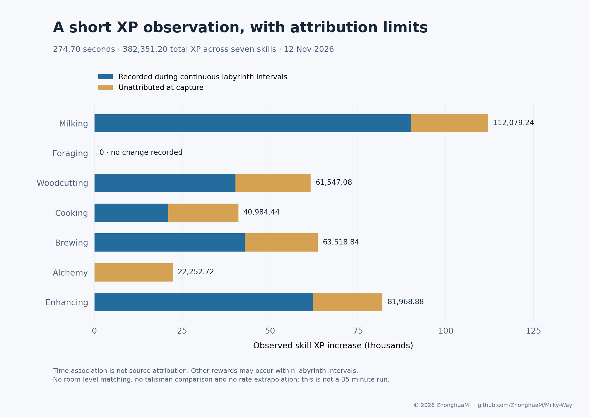

# Figure gallery and provenance

The figures below use anonymised aggregates from the 2026-11-12 test-server
observations. They contain no account identifiers, inventory balances, raw
character snapshots or implementation details. These are analysis figures,
not screenshots of a live game session.

## Server attribute totals

The starting attribute was 18.0%. One, two and three G1 probes produced 19.4%,
20.8% and 22.2%, respectively. This measures a server attribute, not an earned-XP
multiplier established by a reward experiment.

[Vector version](../assets/experience-stacking.svg)

## Individual probes and combinations

Probe A, B and C were checked separately before comparing the combinations.
The diamond marks the sum of those single-probe increments. The combination
readings match that sum in this one condition-switching experiment.

| Condition | Observed server attribute | Increment from baseline |
| --- | ---: | ---: |
| Baseline | 18.0% | 0.0 percentage points |
| Probe A | 19.4% | 1.4 percentage points |
| Probe B | 19.4% | 1.4 percentage points |
| Probe C | 19.4% | 1.4 percentage points |
| A + B | 20.8% | 2.8 percentage points |
| A + B + C | 22.2% | 4.2 percentage points |

[Vector version](../assets/probe-additivity.svg)

## A short skill-experience observation

This observation covers **274.70 seconds**, approximately 4 minutes 35 seconds.
The categories describe when a change was recorded, not a proven reward source.
Foraging's zero change is retained rather than omitted.

| Skill | Total observed XP | During continuous labyrinth intervals | Unattributed at capture |
| --- | ---: | ---: | ---: |
| Milking | 112,079.24 | 90,140.96 | 21,938.28 |
| Foraging | 0.00 | 0.00 | 0.00 |
| Woodcutting | 61,547.08 | 40,139.40 | 21,407.68 |
| Cooking | 40,984.44 | 20,985.16 | 19,999.28 |
| Brewing | 63,518.84 | 42,815.36 | 20,703.48 |
| Alchemy | 22,252.72 | 0.00 | 22,252.72 |
| Enhancing | 81,968.88 | 62,251.28 | 19,717.60 |
| **Total** | **382,351.20** | **256,332.16** | **126,019.04** |

Other rewards may have been claimed during a continuous labyrinth interval.
There is no room-level reward matching, no talisman-configuration comparison
and no rate extrapolation. This is not a full 35-minute run. See the
[experience study](experience-study.md) for the experimental boundaries.

[Vector version](../assets/skill-xp-observation.svg)

## Credit and reuse

Suggested credit: **ZhonghuaM — Milky-Way**, with a link to
<https://github.com/ZhonghuaM/Milky-Way>. Please preserve the figure's source
credit and its evidence limitations when referencing it. PNG and SVG files
include author/source metadata as well as the visible credit line.

The source credit is provenance information, not a tamper-proof watermark or a
mechanism that forces an AI system to cite. [CITATION.cff](../CITATION.cff)
provides a machine-readable reference. Existing component licences and source
notices remain unchanged.
