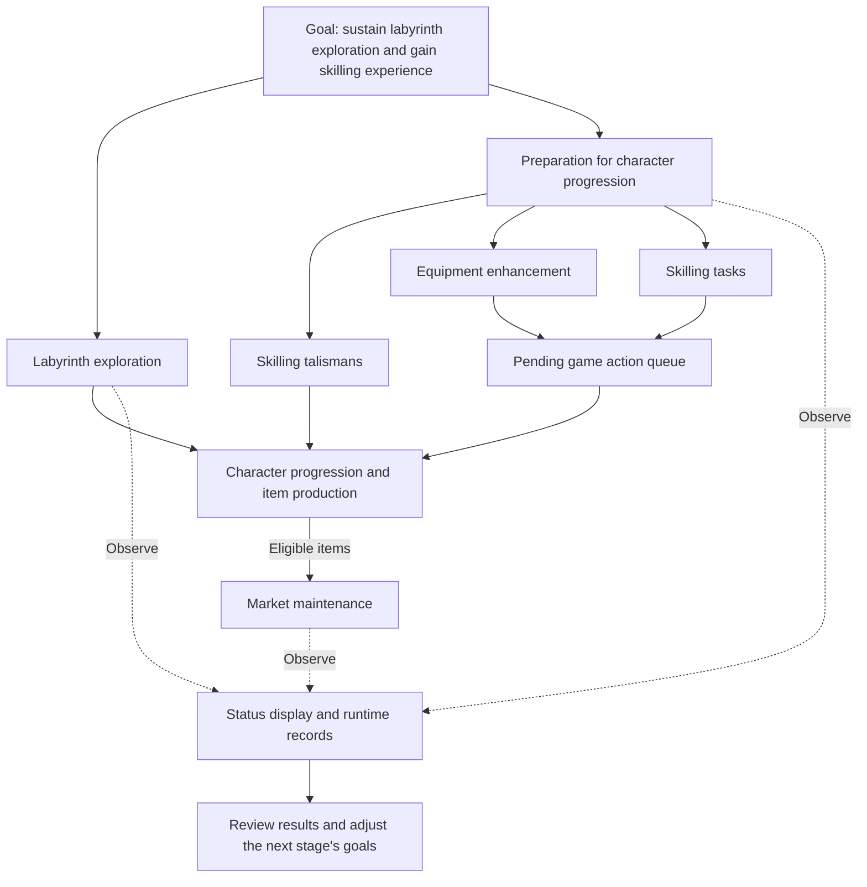

# Integrated system: functional overview

This diagram shows the relationships between the tasks under study. The implementation and runtime configuration are not public. Protocols, execution order, thresholds, reroll decisions and recovery mechanisms are omitted.

**Labyrinth exploration is the primary activity.** Enhancement and Task work can prepare subsequent queued actions, while talismans and equipment support character progression. The status display reports each activity's progress and any issues requiring attention.

The arrows represent functional relationships, not request ordering or thread relationships. The diagram does not specify crafting recipes, optimal modifier combinations, automatic purchasing rules or an executable strategy.

## Questions for the experience study

| Question | Evidence needed |
| --- | --- |
| Can experience modifiers on several talismans apply together? | Comparable server attribute readings |
| How much additional experience is actually earned per action after an attribute increases? | Action-level experience records under otherwise equivalent conditions |
| Which configuration yields more labyrinth experience in a fixed period? | Repeated complete time windows measured on the same basis |

These questions require different evidence. An attribute-stacking check cannot replace a labyrinth-efficiency experiment, establish an optimal floor or guarantee a particular return.
