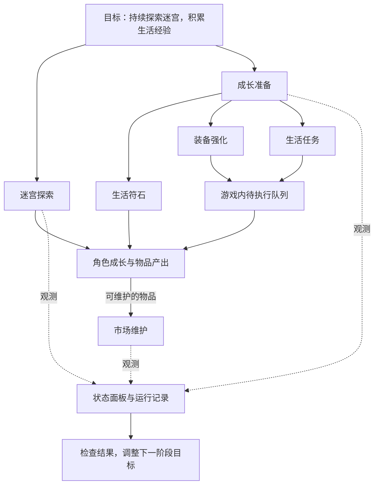

# 整合系统：功能概览

这张图展示目前研究的任务关系。源码与运行配置未公开；图中省略协议、执行顺序、阈值、洗练决策及故障恢复实现。

**迷宫是主要工作。** 强化和任务可以提前准备后续队列；符石与装备服务于角色成长。状态面板分别呈现各项工作的进展和需要关注的问题。

图中的箭头表示功能关系，不代表发送顺序或线程关系。它不包含制作配方、最优词条组合、自动采购规则或可直接执行的策略。

## 经验研究关注什么

| 问题 | 需要什么证据 |
| --- | --- |
| 多颗符石的经验属性是否能共同生效？ | 可比较的服务器属性读数 |
| 属性增加后，每次行动实际多得多少经验？ | 相同条件下的行动经验记录 |
| 哪种配置能在固定时间内获得更多迷宫经验？ | 多轮、同口径的完整时间窗口 |

这三个问题使用不同的证据。属性叠加检查不能直接替代迷宫效率实验，也不能直接给出最优楼层或收益保证。
